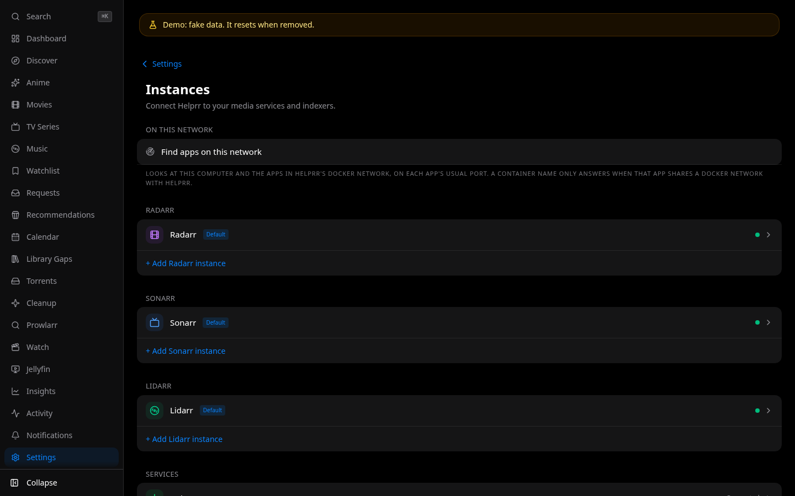

Every app is optional, and connected in **Settings → Instances**. What Helprr shows
depends on which apps you connect, and on what each person is allowed to do.

## Let Helprr find them

- **Find apps on this network** (in **Settings → Instances**) tries each app's usual
  name and port, as in a shared Compose file (`http://sonarr:8989`), and the same ports
  on this machine (`host.docker.internal`) and at Helprr's network gateway. Tap **Add
  its key** on an app it found: for a new connection, the form opens with the address
  filled in. An app on this machine shows up at `host.docker.internal`, or, when that
  does not answer, at Helprr's network gateway, such as `http://172.18.0.1:8989`, which
  works but can change if Docker's network is recreated. Make sure each app it found is
  yours. Apps on other
  machines are not found this way, and when it finds nothing, type the address yourself,
  from the table below.
- **Found in Prowlarr / Seerr**: once Prowlarr or Seerr is connected, Helprr lists the
  Sonarr, Radarr and Lidarr they already know. Seerr gives each app's key, so those add
  as they are; Prowlarr hides keys, so type each one's key first. **Test and add** adds
  the ones you choose.

## Which address to use

Inside Docker, `localhost` means Helprr's own container, never your server. Use:

| Where the app runs | Address | Example |
| --- | --- | --- |
| In the same Compose file as Helprr | The service name and the app's port | `http://sonarr:8989` |
| On the same machine, outside Docker or in another stack | `host.docker.internal` (or the machine's IP address) and the published port | `http://host.docker.internal:8989` |
| On another machine | That machine's IP address or name | `http://192.168.1.10:8989` |

For `host.docker.internal`, the app must listen on all addresses (`0.0.0.0`), not only
`127.0.0.1`, and a host firewall such as ufw may need to allow Docker's networks.

If the app has a base path (Sonarr behind `/sonarr`, for example), add it:
`http://192.168.1.10:8989/sonarr`.

## Test, then save

**Test** checks that the address answers as that app, with that key, and a message at the
edge of the screen says how it went: the app's version when it worked, or why it did not,
in plain words, with a link to [Troubleshooting](/helprr/troubleshooting/). **Save** keeps
it.

If you later change a connection's address, enter its key (or password) again too: a
saved key is only used with the address it was saved for.

## More than one

Sonarr, Radarr and Lidarr can each be connected more than once, such as a second
Sonarr for anime. Each one gets its own name, and the first is the **Default**, the one
Helprr uses when a page needs just one, until you choose another with **Make default**.

## Apps behind a sign-in proxy

When an app sits behind Authelia, Cloudflare Access or another proxy that wants its own
header, set `HELPRR_CUSTOM_HEADERS=true` in `.env`: each connection then takes custom
HTTP headers. A `Host` header is not accepted.
