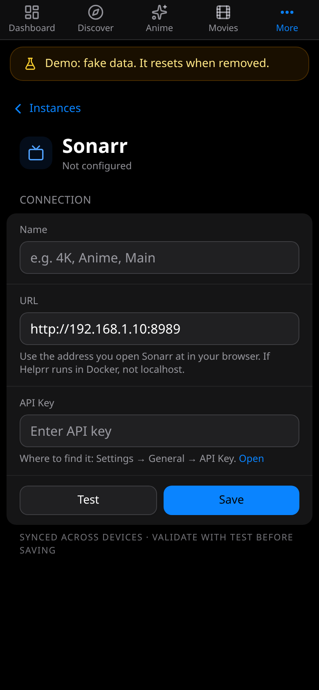

**Usual port:** 8989. **Key:** in Sonarr, **Settings → General → API Key**.

**What it adds:** TV series, episodes and seasons, the calendar, the queue and activity, wanted and missing episodes, adding new series, and file actions.

In **Settings → Instances**, tap **+ Add Sonarr instance** (or **Add its key**, if Find
apps on this network found it). Enter a name (any label,
such as Main), the address ([which one?](/helprr/connect/#which-address-to-use)) and the
key, then **Test**, and **Save** once it works. Every app's form looks like this one.

Connect a second Sonarr (for anime, for example) as its own instance.
