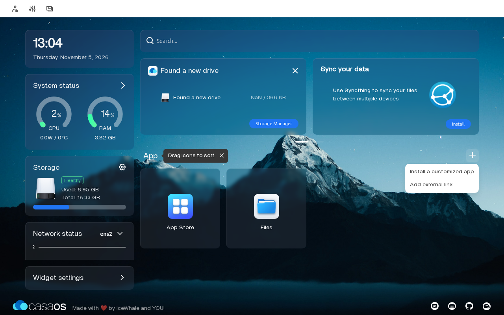
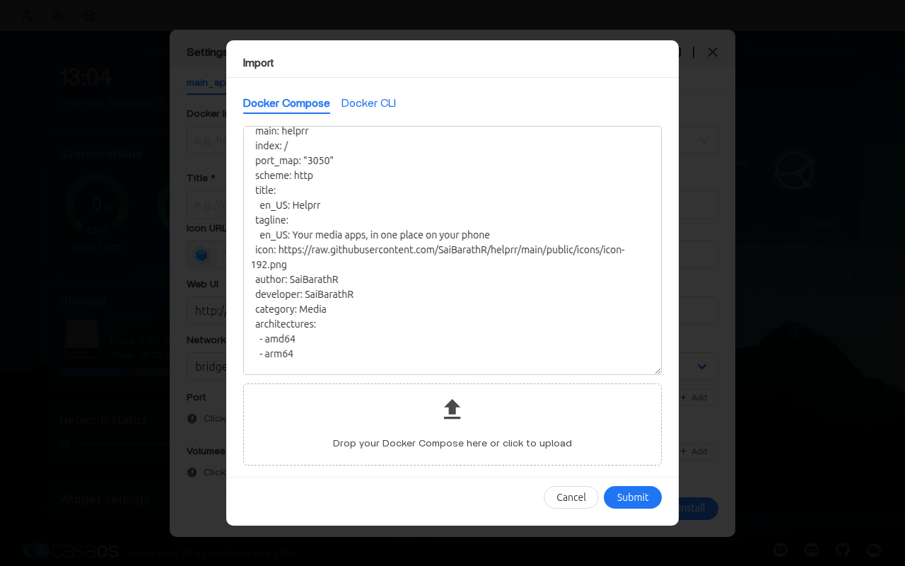
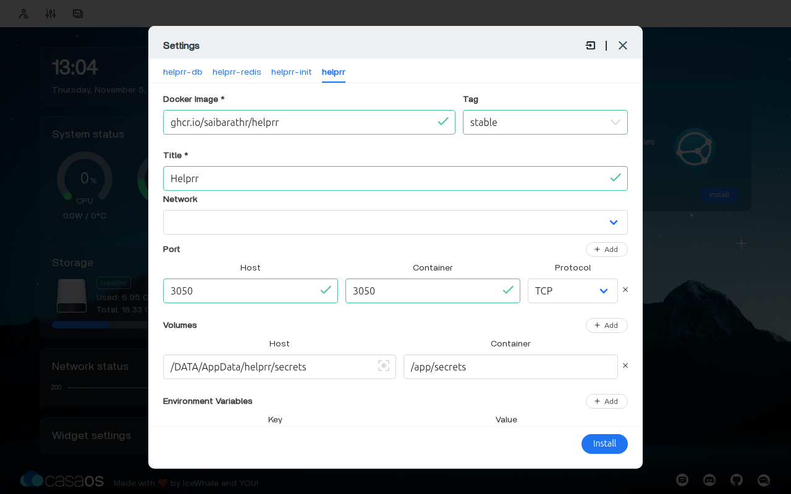
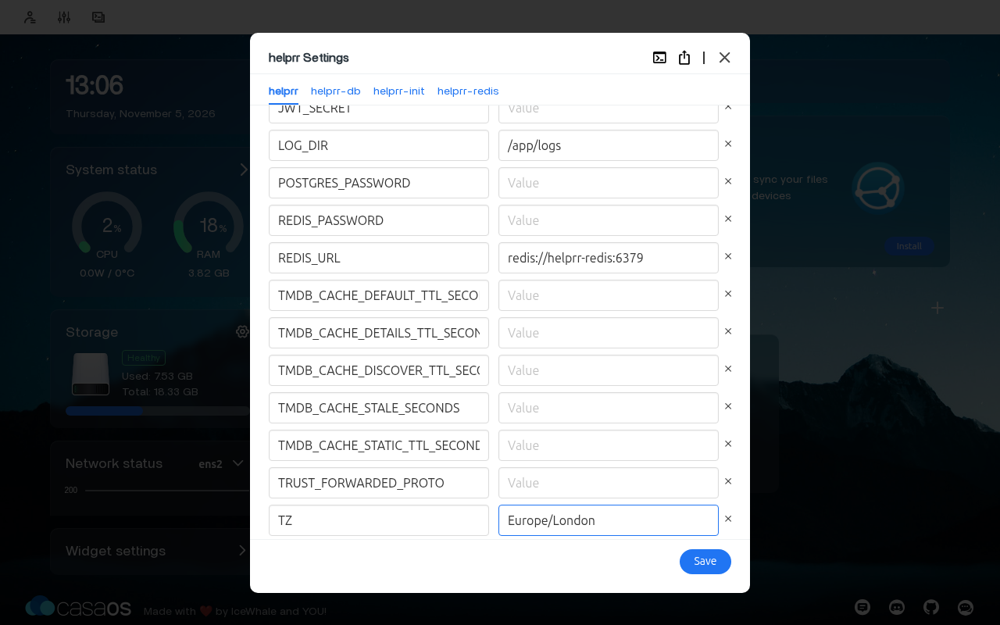
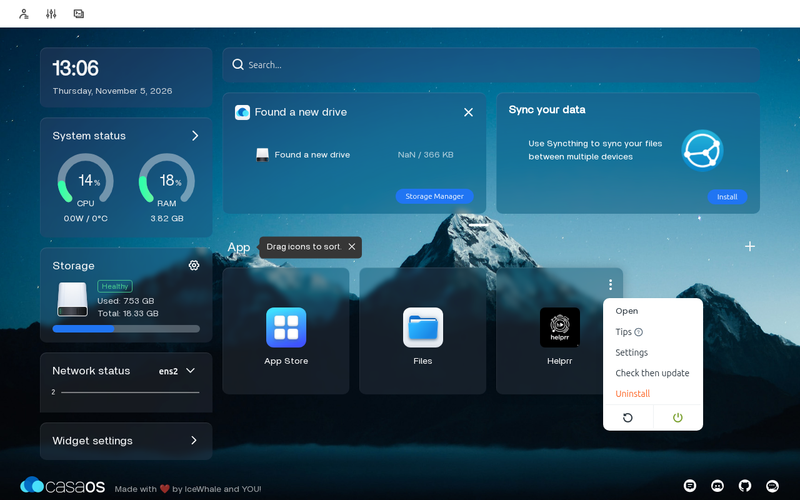
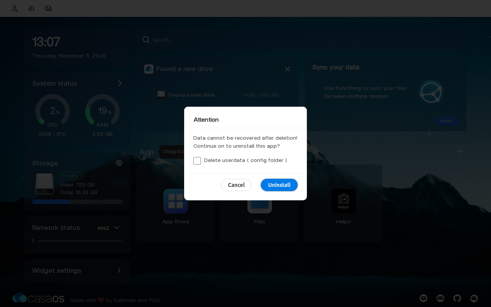

import { Code } from '@astrojs/starlight/components';
import release from '../../../../../docker-compose.yml?raw';
import { casaosCompose } from '../../../lib/app-store-compose.mjs';

Helprr installs in CasaOS as a custom app from one Compose file. There is nothing to type
in a terminal and no secrets to make: Helprr makes its passwords and keys the first time
it starts, and keeps everything in `/DATA/AppData/helprr`.

*Tested 2026-11-05 with CasaOS 0.4.15 on Ubuntu 24.04: install, first run, a restart of
the machine, a settings change, an update, a backup and restore, and uninstalling.*

## 1. Get the Compose file

<a href="/helprr/downloads/casaos/docker-compose.yml" download="docker-compose.yml">Download Helprr's CasaOS Compose file</a>, or
copy it from here. It is Helprr's own Compose file, with its data in CasaOS's folder and
every value written out, as CasaOS needs:

<details>
<summary>docker-compose.yml for CasaOS</summary>

<Code code={casaosCompose(release)} lang="yaml" title="docker-compose.yml" />

</details>

It leaves out the optional Twitch and YouTube worker, which needs folders of its own;
use [Only the Compose file](/helprr/install/compose-only/) or a
[terminal install](/helprr/install/one-command/) for that. Its containers have fixed
names (`helprr`, `helprr-db` and so on), so a machine runs one Helprr: remove another
install first.

## 2. Install it

1. On CasaOS's dashboard, select **+** next to **App**, then **Install a customized app**.

   

2. Select the import icon at the top right of the **Settings** window. On the
   **Docker Compose** tab, paste the file, or drop the downloaded file on the box below
   it, then select **Submit**.

   

3. CasaOS shows a note about what it needs to know; select **OK**. Each part of Helprr
   now has a tab (`helprr-db`, `helprr-redis`, `helprr-init` and `helprr`), already
   filled in. Leave them as they are, and select **Install**.

   

CasaOS pulls the images and starts Helprr; give it a minute or two. A **Helprr** tile
appears on the dashboard. Select it, or open `http://YOUR_SERVER:3050`, and
[create your admin](/helprr/first-run/). Then [connect your apps](/helprr/connect/),
and for push notifications on your phone, see [Phone and push](/helprr/phone-and-push/)
and [HTTPS](/helprr/https/).

## Change a setting

Point at the Helprr tile to show its **⋮** menu, open it, then select **Settings**. On
the **helprr** tab, under **Environment Variables** (in alphabetical order, so `TZ` is
near the end), change the value, such as `TZ` to your timezone, like `Europe/London`.
Then select **Save**. The [environment reference](/helprr/reference/environment/) lists
every setting. Leave `POSTGRES_PASSWORD`, `REDIS_PASSWORD`, `DATABASE_URL`, `JWT_SECRET`
and the `VAPID_` keys empty: Helprr makes those. A password on this tab alone would not
reach its database and Redis, and new keys would end sessions and push.



The tile's **⋮** menu also stops, starts and restarts Helprr.



## Update

[Back up](#back-up) first. Then open the tile's **⋮** menu, **Settings**, and select
**Save** without changing anything: CasaOS pulls the newest Helprr and, if there is a
newer one, restarts Helprr on it. Your data stays. **Check then update** in the same menu works only for apps from CasaOS's
own store, so it does nothing for Helprr.

If the release notes say Helprr's Compose file changed, note the settings you changed,
uninstall Helprr *without* **Delete userdata**, and install the new file as in
[step 2](#2-install-it). Helprr starts again with all your data; set your changed
settings again.

## Back up

Stop Helprr with the power button in the tile's **⋮** menu, and wait until its tile is
greyed out. Then, in a terminal on the CasaOS machine, copy its folder into a file only
you can read:

```bash
( umask 077; sudo tar -C /DATA/AppData -czf - helprr > helprr-backup-$(date +%Y%m%d-%H%M%S).tar.gz )
```

Start Helprr again with the same button. The file has your database and the passwords
and keys Helprr made: keep it private, and copy it off the machine.

To restore, stop Helprr the same way. Then, in the folder with the backup, with its
name in place of the example, check the backup reads in full, set the current data aside
as `helprr.old`, and put the backup in its place:

```bash
backup=helprr-backup-YYYYMMDD-HHMMSS.tar.gz
tar -tzf "$backup" >/dev/null && [ ! -e /DATA/AppData/helprr.old ] &&
  sudo mv /DATA/AppData/helprr /DATA/AppData/helprr.old &&
  sudo tar -C /DATA/AppData -xzf "$backup"
```

Start Helprr again. Once it works, remove the old data:
`sudo rm -rf /DATA/AppData/helprr.old`. If the restore stops partway, put the old data
back instead: `sudo rm -rf /DATA/AppData/helprr && sudo mv /DATA/AppData/helprr.old /DATA/AppData/helprr`.

Restore with the same Helprr as the one that made the backup, or a newer one: a newer
Helprr updates the restored database as it starts.

## Uninstall

Open the tile's **⋮** menu, then **Uninstall**. CasaOS always warns that data cannot be
recovered. Leave the **Delete userdata** box unticked to keep `/DATA/AppData/helprr`, so
installing Helprr again later brings back your data (not the settings you changed). To
remove Helprr's data too, tick the box itself; clicking its words does not tick it.


