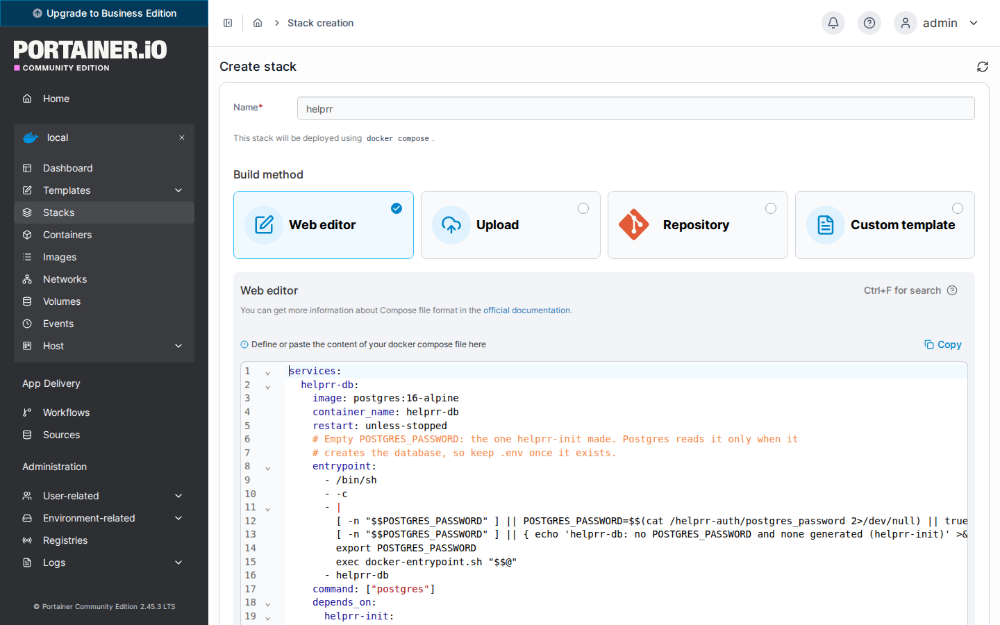
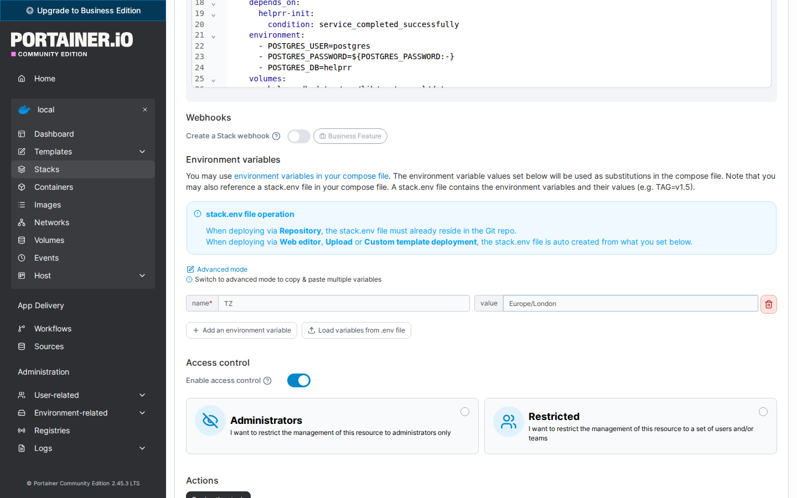
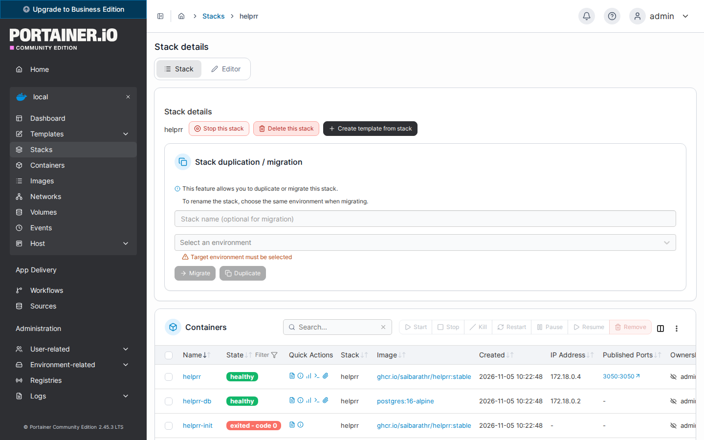
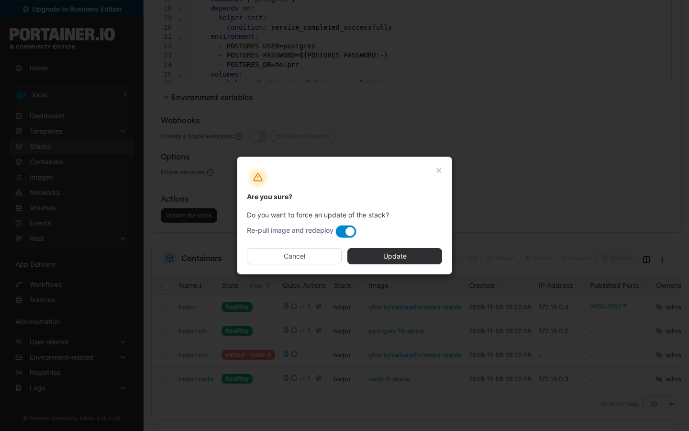

Helprr installs as a Portainer stack from its own Compose file. There is nothing to type
in a terminal and no secrets to make: Helprr makes its passwords and keys the first time
it starts.

*Tested 2026-11-05 with Portainer Community Edition 2.45.3 LTS, on its local Docker
environment: deploy, first run, and an update that kept the data.*

## 1. Add the stack

1. In Portainer, open your environment (usually **local**; on a new Portainer, select
   **Get Started** first), then **Stacks → Add stack**.
2. **Name**: `helprr`.
3. **Build method**: **Web editor**. Open
   [Helprr's Compose file](https://github.com/SaiBarathR/helprr/releases/latest/download/docker-compose.yml),
   copy all of it, and paste it into the editor. If Sonarr and your other apps run in
   their own stack, take the Compose file from
   [Your setup, step by step](/helprr/install/configurator/) instead (choose
   **Portainer**): it adds their network, so Helprr reaches them by name.



## 2. Settings (optional)

Under **Environment variables**, **Add an environment variable** for each setting you
want. None is required; the most useful are:

| Name | Value |
| --- | --- |
| `TZ` | Your timezone, such as `Europe/London` (UTC otherwise) |
| `HELPRR_PORT` | Another port, if 3050 is taken |

Every other setting is in the [environment reference](/helprr/reference/environment/), and
[Your setup, step by step](/helprr/install/configurator/) lists the ones your setup needs.



## 3. Deploy

Press **Deploy the stack**. Portainer pulls the images and starts Helprr; give it a minute
or two. On the stack's page, `helprr`, `helprr-db` and `helprr-redis` show **healthy**.
`helprr-init` shows **exited - code 0**: it makes Helprr's passwords once, then stops, and
that is normal.

If Portainer shows an error instead, it still keeps a stack named `helprr`, so a second
try with that name is refused: **Stacks → helprr → Delete this stack**, fix what the error
said, and add the stack again.



Then open `http://YOUR_SERVER:3050` (your Portainer machine's address, or your
`HELPRR_PORT`) and [create your admin](/helprr/first-run/).

## Update

[Back up](#back-up) first. Then **Stacks → helprr → Editor**. If the release notes say
Helprr's Compose file changed, replace the editor's contents with the new one (from the
same link, or from [Your setup, step by step](/helprr/install/configurator/) if you took
it from there). Select **Update the stack**, turn on **Re-pull image and redeploy**, then
**Update**. Your data stays: it lives in the stack's volumes. Portainer closes the dialog
at once, but Helprr takes a minute or so to stop and start again.



## Back up

Portainer has no backup for a stack's data, so take one in a terminal on Portainer's
machine. It writes two files named with the date and time, which only you can read:

```bash
(
  umask 077
  name=helprr-$(date +%Y%m%d-%H%M%S)
  docker exec helprr-db pg_dump -U postgres -Fc helprr > "$name.dump" &&
    docker run --rm -v helprr-secrets:/s:ro alpine tar -C /s -cf - . > "$name.secrets.tar" &&
    echo "Saved $name.dump and $name.secrets.tar"
)
```

The `.dump` is the database; the `.secrets.tar`, the passwords and keys Helprr made,
which the database needs. Keep both together and private, and copy them off the machine
([Back up and restore](/helprr/maintain/backup/#keep-a-copy-off-the-host) has a way).

## Restore

To roll back an update, first set the variable `HELPRR_VERSION` to the version that
wrote the backup (such as `1.12.1`) in the stack's **Environment variables**, and
**Update the stack**.

If you use the Twitch or YouTube worker, run
`docker stop helprr-twitch-worker` before the steps below, and
`docker start helprr-twitch-worker` after them.

In the folder with the two files, name the backup, and check
that both files read in full, before anything changes:

```bash
dump=helprr-YYYYMMDD-HHMMSS.dump
docker exec -i helprr-db pg_restore --exit-on-error --file=/dev/null < "$dump" &&
  tar -tf "${dump%.dump}.secrets.tar" >/dev/null && echo "Both files read"
```

If the `helprr-secrets` volume was lost or replaced (or this is a new machine), put the
secrets back first. This also restarts Redis with the password from the backup.

```bash
docker stop helprr helprr-redis &&
  docker run --rm -i -v helprr-secrets:/s alpine tar -C /s -xf - < "${dump%.dump}.secrets.tar" &&
  docker start -a helprr-init &&
  docker start helprr-redis
```

Then give the database the password from the backup. This does nothing if you set
`POSTGRES_PASSWORD` yourself:

```bash
docker exec helprr-db test -s /helprr-auth/postgres_password &&
  docker exec -i helprr-db psql -q -U postgres <<'SQL'
\set pw `cat /helprr-auth/postgres_password`
ALTER USER postgres PASSWORD :'pw';
SQL
```

Then restore the database. It reads the whole backup again before it changes anything,
and stops at the first step that fails:

```bash
docker exec -i helprr-db pg_restore --exit-on-error --file=/dev/null < "$dump" &&
  docker stop helprr &&
  docker exec helprr-db dropdb -U postgres --if-exists --force helprr &&
  docker exec helprr-db createdb -U postgres helprr &&
  docker exec -i helprr-db pg_restore -U postgres --exit-on-error -d helprr < "$dump" &&
  docker start helprr
```

## Remove, or start over

**Stacks → helprr → Delete this stack** removes Helprr's containers but keeps its data,
so a new `helprr` stack starts with the same database, users and passwords. To start
from nothing, also delete Helprr's volumes under **Volumes**: `helprr-secrets`,
`helprr-image-cache`, and the ones whose names start with `helprr_`. That deletes
everything Helprr kept, so [back up](#back-up) first if you might want it.
