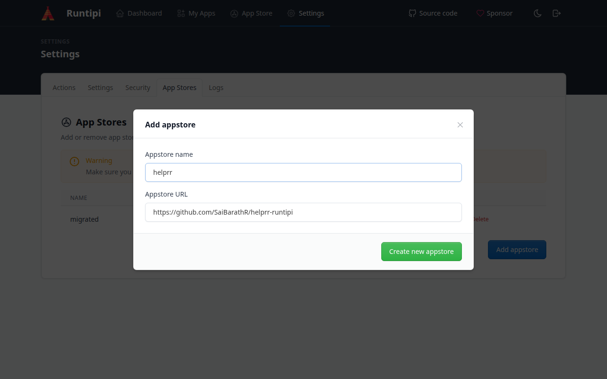
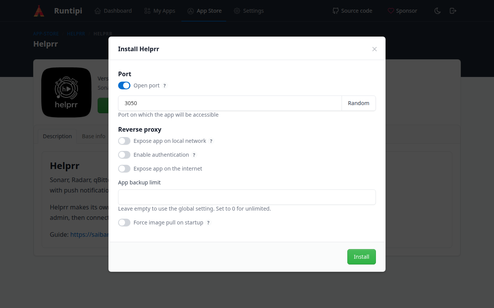
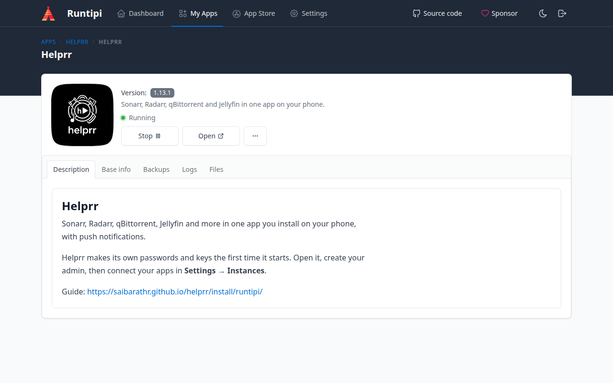
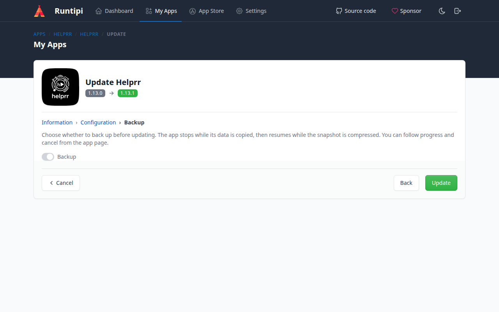
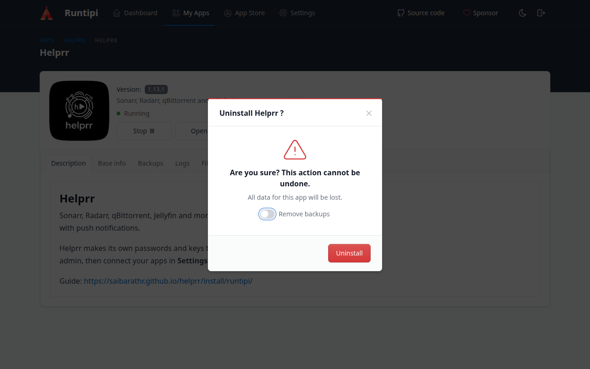

Helprr has its own Runtipi app store. Add it once, then install, update and back up
Helprr from Runtipi's pages, with nothing to type in a terminal and no secrets to make:
Helprr makes its passwords and keys the first time it starts.

*Tested 2026-11-05 with Runtipi 4.12.0 on Ubuntu 24.04: install, first run, stop and
start, a restart of the machine, an update, a backup and restore, and removing it.*

## 1. Add Helprr's app store

In Runtipi, open **Settings → App Stores → Add appstore**:

- **Appstore name**: `helprr`
- **Appstore URL**: `https://github.com/SaiBarathR/helprr-runtipi`

Select **Create new appstore**.



## 2. Install

Open **App Store**, search for `helprr`, open **Helprr**, and select **Install**. Keep
**Open port** on with port `3050` (or choose another), then select **Install**.



Runtipi pulls the images and starts Helprr; give it a minute or two. When it shows
**Running**, select **Open** and then the address it offers, or open
`http://YOUR_SERVER:3050`, and [create your admin](/helprr/first-run/). Then
[connect your apps](/helprr/connect/), and for push notifications on your phone, see
[Phone and push](/helprr/phone-and-push/) and [HTTPS](/helprr/https/).



Helprr keeps its data in Runtipi's folder (`runtipi`, in the home folder of whoever
installed Runtipi), under `app-data/helprr/helprr`, and takes Runtipi's timezone. Its
containers have fixed names (`helprr`, `helprr-db` and so on), so a machine runs one
Helprr: remove another install first. The optional Twitch and YouTube worker is not part
of the Runtipi app; use a [terminal install](/helprr/install/one-command/) for that.

## Change a setting

Settings from the [environment reference](/helprr/reference/environment/) go in a file
of Runtipi's for your own changes, `user-config/helprr/helprr/docker-compose.yml` in
Runtipi's folder. Runtipi keeps it across updates. In a terminal on the Runtipi machine,
as the user who installed Runtipi:

```bash
cd ~
sudo mkdir -p runtipi/user-config/helprr/helprr
sudo nano runtipi/user-config/helprr/helprr/docker-compose.yml
```

List your settings under Helprr's service, such as:

```yaml
services:
  helprr:
    environment:
      - ARR_CALLBACK_ORIGIN=http://192.168.1.10:3050
```

Then **Stop** and **Start** Helprr on its page in Runtipi. Leave `POSTGRES_PASSWORD`,
`REDIS_PASSWORD`, `DATABASE_URL`, `JWT_SECRET` and the `VAPID_` keys out: Helprr makes
those. A password here would not reach its database and Redis, and new keys would end
sessions and push.

## Update

Each Helprr release updates the app store. To see it, open **Settings → Actions → Update
App Stores**, select **Update**, and **Update** again to confirm. Helprr's **⋯** menu
then shows **Update**: follow its steps. In the last one, **Backup** is on by default
(its switch is pale even when on); leave it on, so Runtipi backs Helprr up first. The
update takes a minute or two, most of it Helprr finishing its work before it stops.



## Back up

On Helprr's page, the **Backups** tab has **Backup now** (confirm with **Backup**):
Runtipi stops Helprr, copies its folder, and starts it again. Each backup there also has
**Download** and **Restore**. Restoring replaces all of Helprr's data with the backup's,
and puts back the Helprr version that made it, so it also undoes an update. The backups
have your database and the passwords and keys Helprr made: download them to keep a copy
off the machine, and keep them private.

## Remove

Helprr's **⋯** menu → **Remove**, then **Uninstall**, removes Helprr and its data. Its
backups stay, so installing Helprr again can restore one, unless you turn on **Remove
backups**: do that to remove everything, as the backups hold Helprr's passwords and keys.


