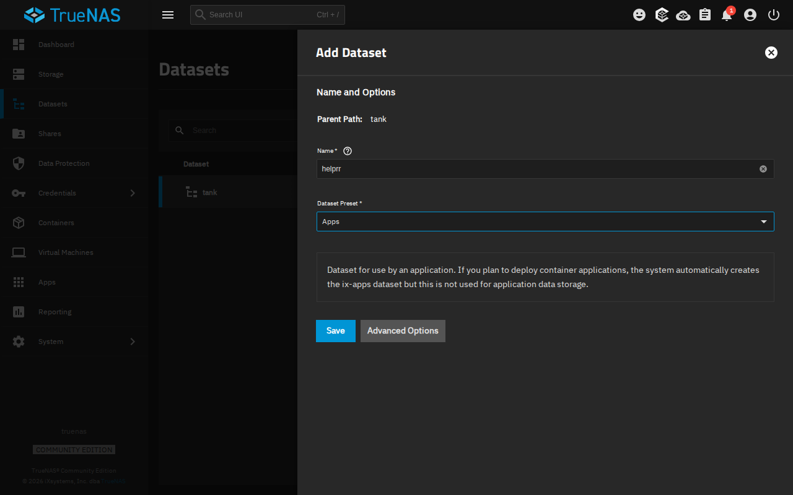
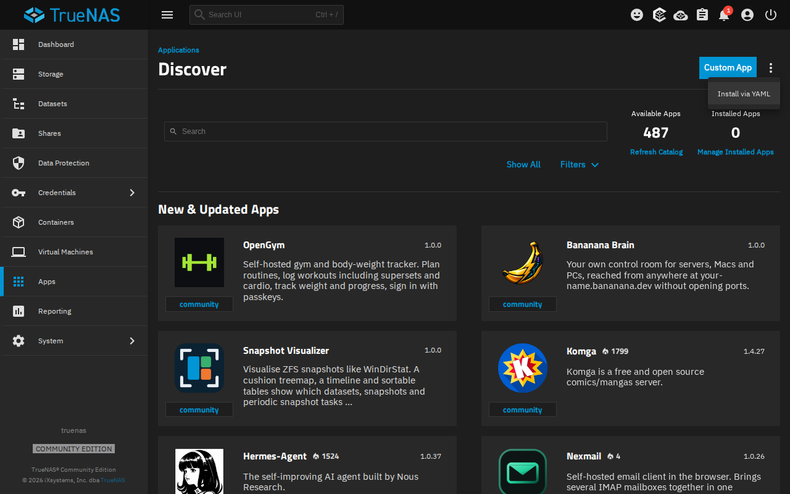
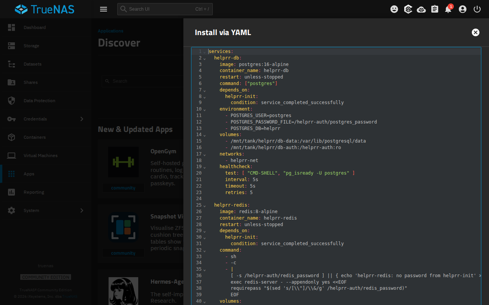
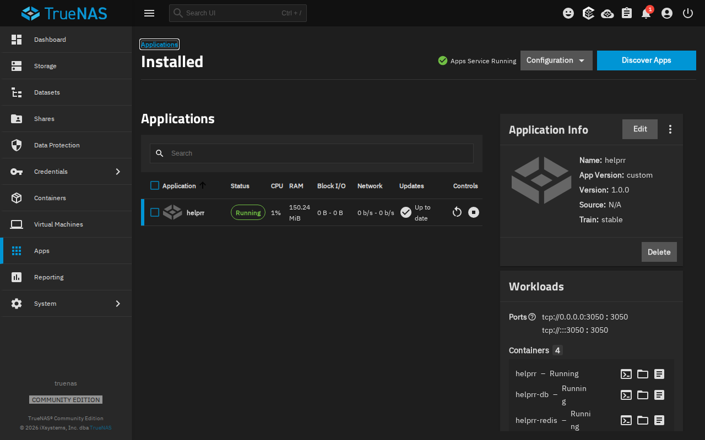
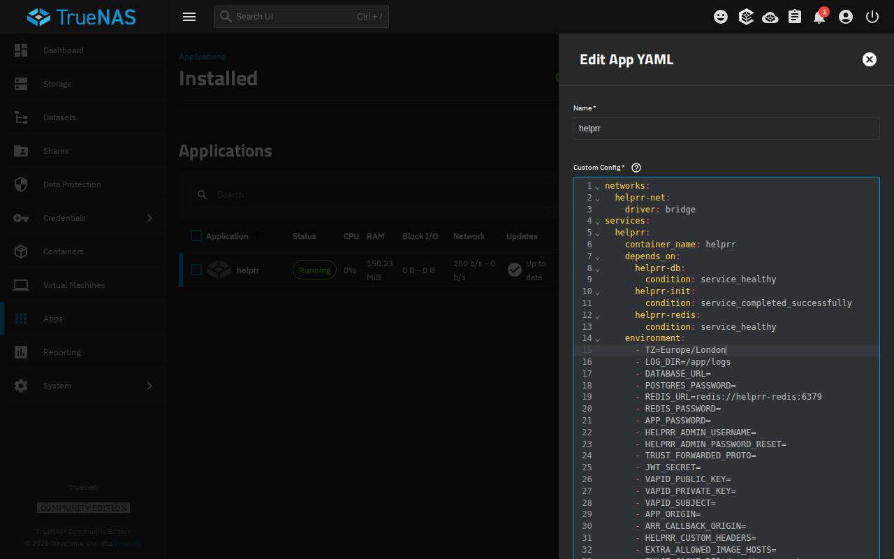
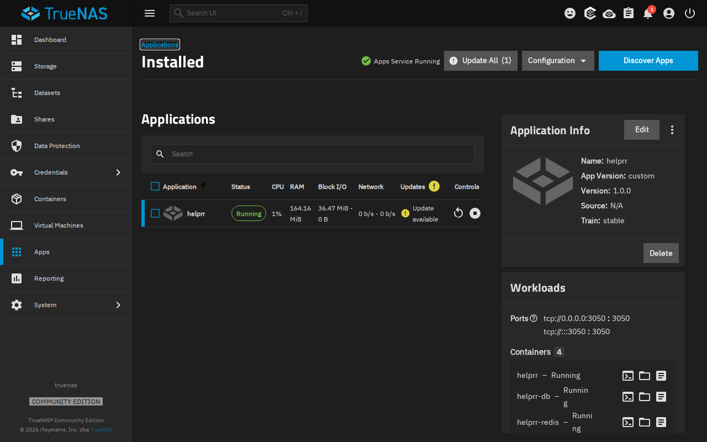
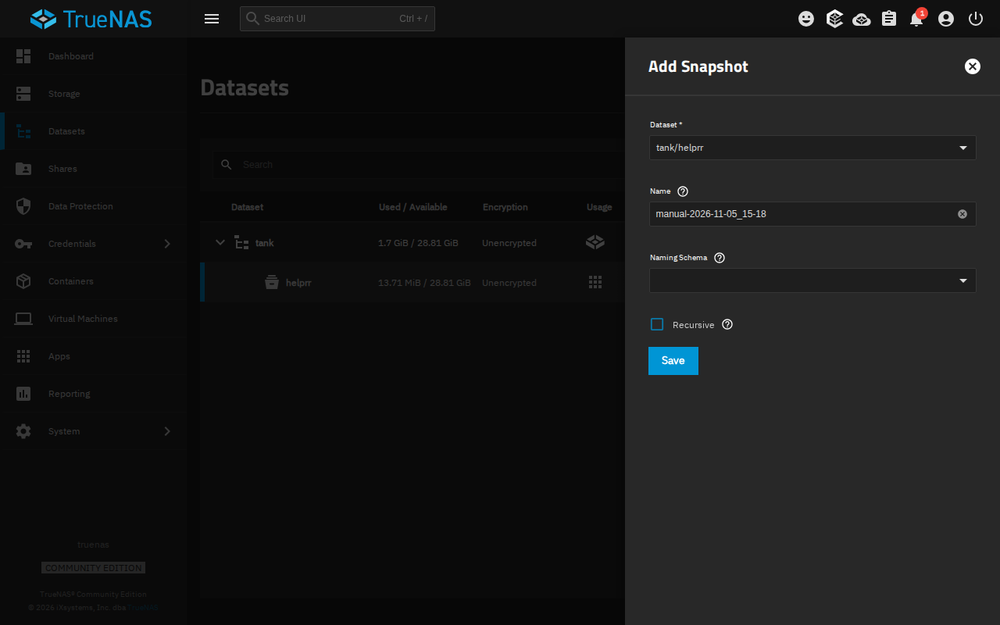
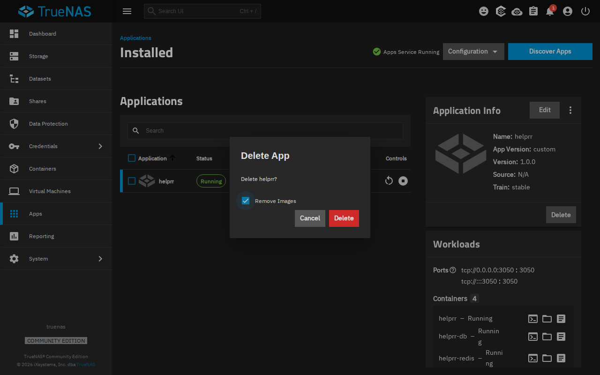

import TrueNasCompose from '../../../components/TrueNasCompose.astro';

Helprr installs on TrueNAS as a custom app from one Compose file, and keeps all its data
in a `helprr` dataset: back it up with TrueNAS's snapshots. There is nothing to type in a
terminal and no secrets to make: Helprr makes its passwords and keys the first time it
starts.

*Tested 2026-11-05 with TrueNAS Community Edition 25.10.7: install, first run, a restart
of TrueNAS, a settings change, an update, a snapshot and rollback, and deleting and
installing again.*

You need a pool, and Apps set to use it (**Apps → Configuration → Choose Pool**), as
TrueNAS asks the first time you open **Apps**.

## 1. Make a dataset for Helprr

Open **Datasets**, select your pool, then **Add Dataset**. **Name**: `helprr`, **Dataset
Preset**: **Apps**, then **Save**.

## 2. Get the Compose file

Type your pool's name, and copy the file. It is Helprr's own Compose file, with its data
in the dataset you made:

<TrueNasCompose />

It leaves out the optional Twitch and YouTube worker, which needs folders of its own.
Its containers have fixed names (`helprr`, `helprr-db` and so on), so a machine runs one
Helprr.

## 3. Install it

1. Open **Apps → Discover Apps**. Next to **Custom App**, open the **⋮** menu, and select
   **Install via YAML**.

   

2. **Name** (above the editor): `helprr`. Paste the file into **Custom Config**, and
   select **Save**.

   

TrueNAS pulls the images and starts Helprr; give it a minute or two. **Apps** then shows
Helprr **Running**, with `helprr-init` **Exited**: it makes Helprr's passwords, then
stops, and that is normal. Open `http://YOUR_TRUENAS:3050` and
[create your admin](/helprr/first-run/). Then [connect your apps](/helprr/connect/), and
for push notifications on your phone, see [Phone and push](/helprr/phone-and-push/) and
[HTTPS](/helprr/https/).

## Change a setting

In **Apps**, select Helprr, then **Edit**. Change the setting's line, such as `- TZ=UTC`
to your timezone, like `- TZ=Europe/London`, then select **Save**: TrueNAS starts Helprr
again with it. The [environment reference](/helprr/reference/environment/) lists every
setting. Leave `POSTGRES_PASSWORD`, `REDIS_PASSWORD`, `DATABASE_URL`, `JWT_SECRET` and the
`VAPID_` keys empty: Helprr makes those. A password here would not reach its database
and Redis, and new keys would end sessions and push.

TrueNAS shows the file in its own order once saved; that is normal.

## Update

TrueNAS checks for newer images by itself. When Helprr's **Updates** column shows
**Update available**, [take a snapshot](#back-up) first, then select **Update All** and
**Update**. **Update All** updates every app that shows an update, not only Helprr. TrueNAS pulls the new Helprr and starts it, and your data stays in the
dataset.

If the [release notes](https://github.com/SaiBarathR/helprr/releases) say Helprr's
Compose file changed, take the new file from
[step 2](#2-get-the-compose-file), then **Edit**, replace the whole file with it, and
**Save**. Set again any setting you changed.

## Back up

Open **Datasets**, select `helprr`, and under **Data Protection** select **Take
Snapshot**, then **Save**. A snapshot holds the whole folder at one moment (the database
and the passwords and keys Helprr made), so Helprr can keep running: restoring it is like
starting again after a power cut, which Helprr's database is made for. TrueNAS can also
take snapshots on a schedule and copy them to another machine (**Data Protection**).

To restore one:

1. In **Apps**, stop Helprr with the stop button in its row.
2. In **Datasets**, select `helprr`, then **View Snapshots**. Select the snapshot, then
   **Rollback**, tick **Confirm**, and select **Rollback**. This removes everything
   written after that snapshot. If newer snapshots of `helprr` exist, TrueNAS refuses;
   the window's other choices go ahead but **delete those newer snapshots** too.
3. Start Helprr again with the start button in the same place.

Restore with the same Helprr as the one that made the snapshot, or a newer one: a newer
Helprr updates the restored database as it starts.

## Delete

In **Apps**, select Helprr, then **Delete**, and **Delete** again (**Remove Images** only
removes the downloaded images, not your data). The `helprr` dataset stays, so installing Helprr again later (same name, same file) brings back your data,
but not the settings you changed. To remove Helprr's data too, delete the `helprr`
dataset in **Datasets**.

