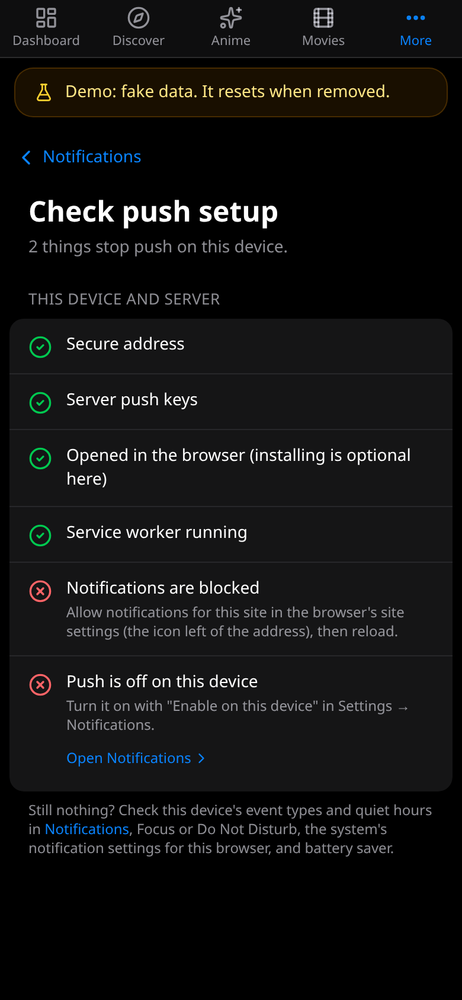

Helprr is a web app you can install. On an iPhone, push notifications work only in the
installed app, and only when Helprr is reached over HTTPS.

## 1. Reach Helprr over HTTPS

Browsers allow notifications only on an `https://` address (or `localhost`). Helprr
does not serve HTTPS itself: put it behind [HTTPS](/helprr/https/) first, and open it at
that address.

## 2. Open it on your phone

**Settings → Appearance → App → Open on your phone** (or **Show code** on the
dashboard's setup list) shows a QR code of the address you are on. Scan it with the
phone's camera.

## 3. Install it

- **iPhone and iPad:** in Safari, tap **Share**, then **Add to Home Screen**, and open
  Helprr from the Home Screen. Push needs iOS 16.4 or later; Helprr supports the latest
  two major iOS versions.
- **Android:** in Chrome, open the menu and tap **Install app** (or **Add to Home
  screen**). On Android, push also works in the browser itself.

## 4. Turn on notifications

In **Settings → Notifications**, turn notifications on for this device and allow them
when asked. Choose which events you want there too. To get them in ntfy, Gotify,
Apprise, a webhook or email as well, see [Notifications](/helprr/notifications/).

## When push is off

**Settings → Notifications → Check push setup** checks each thing push needs on this
device, and says what to do about any that fail: a secure address, a browser that can
do push, the server's push keys, the iOS version, opening the installed app, the
service worker, permission to notify, and whether this device gets push.



**Send a test notification** comes through even during quiet hours, and **Check push
setup** has a **Quiet hours** row that says when they are on now. Other notifications are
not sent during quiet hours (they still show in Notifications), except health warnings
and their all-clear, a service going down or coming back, and security alerts.

A Sonarr, Radarr or Lidarr **Health Warning** opens that instance's health in
**Settings → Service status**: each check's type, message and a link to the app's
own help. Tap an instance's row there to see it any time. When all of the
warnings of Sonarr, Radarr or Prowlarr have cleared and stayed clear for 2 minutes,
**Health Restored** follows; a warning that clears and comes back within those 2
minutes sends nothing. Each device can turn it
off in **Settings → Notifications → Sonarr / Radarr**; a device from before starts with
the choice it had for **Health Warning**.

When Sonarr or Radarr replaces a file with a better copy, you get **Episode Upgraded**
or **Movie Upgraded** instead of "Imported", saying from which quality to which (for
example "WEBDL-1080p → Bluray-2160p"). To hear only about new arrivals, turn off
**Media Upgraded** in **Settings → Notifications → Sonarr / Radarr**; it is on for a
new device, and a device or channel from before starts with the choice it had for
**Media Imported**.

Four more Sonarr / Radarr events tell about changes made anywhere, in Helprr, in the app
itself or by its import lists: **Title Added** and **Title Deleted** (a series or movie
added to or removed from the library, a minute or two after it happens), **File
Deleted** (an episode or movie file deleted, or found missing from disk; a file an
upgrade replaces is not counted) and **Files Renamed** (once per series or movie,
however many files it renamed). **Settings → Notifications → Services → App Update
Available** tells admins once a day when Sonarr, Radarr, Lidarr or Prowlarr has a new
version, once per version; it opens **Settings → Service status**. All five are off
until you turn them on, on each device and channel (they can be noisy: an import list
can add a hundred titles at once), and while nobody has them on they are not listed in
Notifications either. A download that needs a manual import (the apps' "Manual
Interaction Required") is **Import Failed**, as before.

Two qBittorrent events tell about a download in trouble. **Torrent Errored** comes when
a torrent stops on an error or finds its files missing (for example a disk that went
away); it opens the torrent's settings, where **Location** can point it at its files
again. **Torrent Stalled** comes when a download has had no data, or a magnet no
metadata, for the time set under it in **Settings → Notifications → qBittorrent →
Stalled for** (30 minutes by default; admins choose from 5 minutes to 24 hours, for
everyone). It opens the torrent's trackers, whose messages usually say why. Each comes
once each time a torrent gets into that state, and again only after it has recovered
(for a stall: had data for that same time again); a stall is timed from when Helprr
first sees it, also after Helprr restarts. Both are
off until you turn them on, on each device and channel, including ones from before
Helprr had them.

**Settings → Notifications → Service outages → Alert after** sets how long a service
must stay unreachable before the "is unreachable" notification (2 minutes by default;
Immediately, or up to 30 minutes). A shorter blip, such as the internet dropping for a
few seconds, sends nothing, and "is back online" comes only after an "is unreachable".
Helprr checks at each polling cycle (**Settings → Preferences → Polling**), so the
notification comes at the first check after the wait. The wait starts again when Helprr
restarts.

A disabled account, or one whose invite isn't accepted yet, gets no notifications. Its
devices are kept, so notifications come back when an admin turns the account on again.

Films and albums are released on a day, not at a time. With **Settings → Notifications
→ Upcoming releases → Timing** set to **Before air time**, Helprr counts down to midnight
at the start of that day in each person's time zone. With the default 60 minutes, the
notification comes at about 23:00 the evening before. During quiet hours it isn't sent,
like any other notification, but it still shows in Notifications.

If a device stops getting notifications, turn them off and on again in **Settings →
Notifications**. **Settings → Notifications → Devices** lists only your own devices,
admins included, and **Revoke all** turns off push only on them.

## Notifications just for you

Two notifications go only to the person they are about:

- **Now in your library**: a movie or series on your watchlist has been imported. On
  Android and desktop it has a **Remove from watchlist** button; on iPhone, tap it and
  choose there. You get it once per title, and not for quality upgrades.
- **New episode**: Sonarr imported a new episode of a show you played in Jellyfin
  recently. **Settings → Notifications → Watchlist** sets how recently (Off, 7, 14, 30,
  60 or 90 days; 14 by default). It needs your own Jellyfin account, linked in
  **Settings → Account**. Three or more at once arrive as one grouped notification
  when grouping is on.

Both are on by default and follow each device's choices and your quiet hours.

## Use your own push keys

Helprr makes its push keys (VAPID keys) on the first start, in the `helprr-secrets`
volume. To use your own instead, set all three in `.env`, then restart Helprr
(`docker compose up -d --no-build --no-deps helprr`); no rebuild is needed:

```dotenv
VAPID_SUBJECT=mailto:you@example.com
VAPID_PUBLIC_KEY=generated-public-key
VAPID_PRIVATE_KEY=generated-private-key
```

Generate a pair with `npx web-push generate-vapid-keys`. Values in `.env` always win,
and a key from `.env` is never paired with a generated one.

After the keys change, each device replaces its subscription the next time Helprr is
opened on it, and keeps its event choices. Until then, **Devices** still shows it with
its last delivery.

## Subscribe in your calendar app

**Calendar → Subscribe in Calendar** (in the ⋯ menu on smaller screens) makes a private
link that Apple Calendar, Google Calendar, Outlook and other calendar apps can subscribe
to. It shows the same episodes, film releases and albums as Helprr's Calendar, from 30
days back to 180 days ahead. Episodes have their air time; film and album releases are
all-day events on the day they come out in your time zone (**Settings → Preferences →
Date & Time**). Albums are left out for anyone without the Music permission.

Each person can have up to 10 links, each with a name and its own filters (type,
instance, monitored only). A link is shown once, when you make it: **Copy link** gives
the `https://` address, and **Open in Calendar app** opens it as `webcal://`. To see a
link again, make a new one and turn the old one off.

The calendar app fetches the link itself, every few hours. Apple Calendar on an iPhone
fetches it from the phone, so it works over your home network or VPN. Google Calendar
and Outlook.com fetch it from their own servers, so for those Helprr must be reachable
from the internet over HTTPS. Set `APP_ORIGIN` to that address, so links you make on your
home network use it too.
