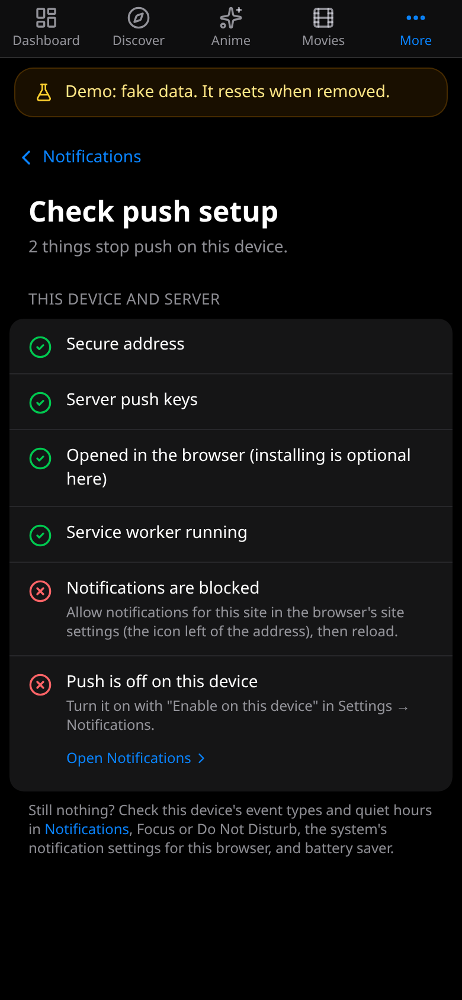

Helprr is a web app you can install. On an iPhone, push notifications work only in the
installed app, and only when Helprr is reached over HTTPS.

## 1. Reach Helprr over HTTPS

Browsers allow notifications only on an `https://` address (or `localhost`). Helprr
does not serve HTTPS itself: put it behind [HTTPS](/helprr/https/) first, and open it at
that address.

## 2. Open it on your phone

**Settings → Appearance → App → Open on your phone** (or **Show code** on the
dashboard's setup list) shows a QR code of the address you are on. Scan it with the
phone's camera.

## 3. Install it

- **iPhone and iPad:** in Safari, tap **Share**, then **Add to Home Screen**, and open
  Helprr from the Home Screen. Push needs iOS 16.4 or later; Helprr supports the latest
  two major iOS versions.
- **Android:** in Chrome, open the menu and tap **Install app** (or **Add to Home
  screen**). On Android, push also works in the browser itself.

## 4. Turn on notifications

In **Settings → Notifications**, turn notifications on for this device and allow them
when asked. Choose which events you want there too. To get them in ntfy, Gotify,
Apprise, a webhook or email as well, see [Notifications](/helprr/notifications/).

## When push is off

**Settings → Notifications → Check push setup** checks each thing push needs on this
device, and says what to do about any that fail: a secure address, a browser that can
do push, the server's push keys, the iOS version, opening the installed app, the
service worker, permission to notify, and whether this device gets push.



If a device stops getting notifications, turn them off and on again in **Settings →
Notifications**.

## Use your own push keys

Helprr makes its push keys (VAPID keys) on the first start, in the `helprr-secrets`
volume. To use your own instead, set all three in `.env`, then restart Helprr
(`docker compose up -d --no-build --no-deps helprr`); no rebuild is needed:

```dotenv
VAPID_SUBJECT=mailto:you@example.com
VAPID_PUBLIC_KEY=generated-public-key
VAPID_PRIVATE_KEY=generated-private-key
```

Generate a pair with `npx web-push generate-vapid-keys`. Values in `.env` always win,
and a key from `.env` is never paired with a generated one.

After the keys change, each device replaces its subscription the next time Helprr is
opened on it, and keeps its event choices. Until then, **Devices** still shows it with
its last delivery.
