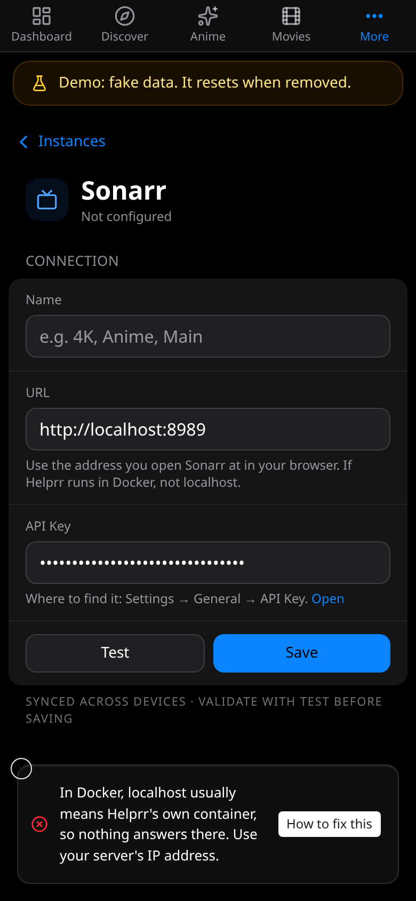

## Starting Helprr

### all predefined address pools have been fully subnetted

`docker compose up` stops with this when Docker has no room for another network. Each
Compose app gets at least one network of its own, and Docker's default settings have
room for about 30, so a computer that already runs many apps runs out. Helprr has not
started; its volumes may already exist, which is fine. Fix it and run the same command
again.

- Remove networks you no longer need. This lists the ones no running container uses:

  ```bash
  docker network ls --filter dangling=true
  ```

  The list also has the networks of apps that are only stopped, and networks you made
  yourself with `docker network create` for several apps to share. Removing one of
  those can stop the apps that use it from starting again. Remove only the ones you are sure about,
  such as those of apps you deleted, one at a time:

  ```bash
  docker network rm NAME
  ```

  Avoid `docker network prune`: it removes the whole list at once.
- If every network is in use, give Docker more, smaller networks with the
  `default-address-pools` setting in Docker's `daemon.json` (in Docker Desktop:
  **Settings → Docker Engine**), as
  [Docker's documentation](https://docs.docker.com/reference/cli/dockerd/) describes.
  Choose addresses that neither your home network nor any existing Docker network uses:
  Docker does not split a network that already exists, and overlapping your home network
  leaves containers unable to reach your devices. This lists every network's addresses:

  ```bash
  docker network inspect $(docker network ls -q) --format '{{.Name}} {{range .IPAM.Config}}{{.Subnet}} {{end}}'
  ```

  The setting applies to networks made after the change, and only once Docker restarts
  (Docker Desktop: **Apply & restart**). Restarting Docker stops every container; only
  those set to restart by themselves come back.

## Connecting an app

When **Test** fails, Helprr says why in plain words and links to the matching section
here with **How to fix this**. The address in each example is yours to change.



### Not a valid address

The address must start with `http://` or `https://`, then a name or IP address, then the
port: `http://192.168.1.10:8989`.

### localhost does not reach your server

Inside Docker, `localhost` and `127.0.0.1` mean Helprr's own container, so nothing
answers there. Use the server's IP address, such as `http://192.168.1.10:8989`. When the
app runs on the same machine as Helprr, `http://host.docker.internal:8989` works too, if
the app listens on all addresses (`0.0.0.0`) and the host firewall allows Docker's
networks. See [Which address to use](/helprr/connect/#which-address-to-use).

### It answered, but not as that app

Something answered at that address, but not that app's API. Usually:

- the address has a page after the port, such as `/settings/general`: remove it;
- the app runs under a base path, such as `/sonarr`: add it;
- the port belongs to a different app.

For TMDB the address is always `https://api.themoviedb.org/3`.

### Nothing is answering

Nothing listens at that address and port. Check the port number, that the app is
running, and that it listens on all addresses (`0.0.0.0`), not only `127.0.0.1`.

### The name is not found

Helprr cannot turn that name into an address. From inside Docker, only names your
network's DNS knows work (and the names of other services in the same Compose file).
Use the server's IP address instead.

### No answer in time

The address took too long to answer. A firewall may be dropping the connection (ufw on
the app's machine, for example), or the address may be wrong.

### The address cannot be reached

Helprr's machine has no route to that address. Check the IP address, and that both
machines are on the same network (or that the VPN between them is up).

### The connection was cut off

The app closed the connection. Usually the address starts with the wrong one of `http`
and `https`: if the app uses HTTPS, start the address with `https://`; if it does not,
use `http://`. Check the port too.

### That port speaks plain HTTP

The address starts with `https://`, but that port answers plain HTTP. Start it with
`http://` instead.

### The certificate was refused

The app's HTTPS certificate is self-signed, expired, or for another name, so Helprr does
not trust it. Use the app's plain `http://` address on your network, or give the app a
certificate from a trusted authority.

### The key was refused

The app answered and turned the key down. Copy it again from the app (see
[Connect your apps](/helprr/connect/) for where each one is), and check for spaces. For
Jellyfin, use an admin API key from **Dashboard → Advanced → API Keys**. For
qBittorrent, check the Web UI username and password, set in qBittorrent's **Tools →
Options → Web UI → Authentication**.

### qBittorrent blocks Helprr

qBittorrent, or a proxy in front of it, refused Helprr. After several wrong passwords
(five, by default) qBittorrent blocks the address they came from for a while (an hour,
by default): wait, then test again with the right password, or lower the ban time in
**Tools → Options → Web UI → Authentication**. If a proxy, firewall or sign-in service
sits in front of qBittorrent, let Helprr through, or use qBittorrent's own address.

### The address redirects

The address sends Helprr on to another address, which Helprr does not follow. Enter the
address the app itself answers on, usually its IP address and port rather than a
proxy's address.

## Signing in

While no one has signed in, the last lines Helprr logs as it starts
(`docker compose logs helprr`) say how to sign in:

- **Open it and create your admin account**: there is no account yet, and no
  `APP_PASSWORD`. See [First run](/helprr/first-run/).
- **No admin can sign in yet: set APP_PASSWORD**: users exist but none is an admin. Set
  `APP_PASSWORD` in `.env` and restart Helprr.
- **APP_PASSWORD did not create one**: the warning above it says why, usually a password
  under 15 characters. Fix it in `.env` and restart.
- **Forgot the admin password**: set `APP_PASSWORD` to a new one (at least 15
  characters) and `HELPRR_ADMIN_PASSWORD_RESET=true`, restart, sign in, then remove
  `HELPRR_ADMIN_PASSWORD_RESET`.

## Push notifications

**Settings → Notifications → Check push setup** checks each thing push needs on that
device and says what to do. See [Phone and push](/helprr/phone-and-push/).

## YouTube

See [YouTube: when something goes wrong](/helprr/youtube/#when-something-goes-wrong).

## Asking for help

**Settings → Service status → Support bundle** downloads a diagnostic file, with
credentials removed. Read it before you share it: it still describes your setup. See
[Update notices and support bundles](/helprr/maintain/update/#update-notices-and-support-bundles).
